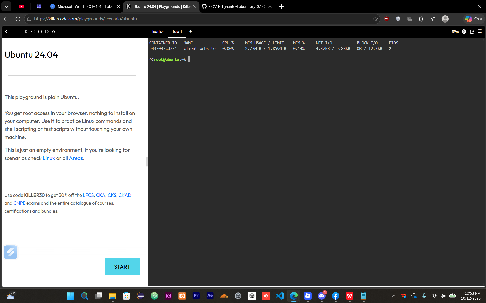

# HTTP 404 Error Log

```text
172.17.0.1 - - [12/Oct/2026:14:35:15 +0000] "GET /hidden-admin-page HTTP/1.1" 404 153 "-" "curl/8.5.0" "-"
```

Application logs help identify errors and show which requests failed. They help cloud operations engineers troubleshoot problems and understand what happened in an application.


## 📊 Real-Time Container Metrics

- **Container Name:** `client-website`
- **Memory Usage:** `2.73MiB`
- **CPU Usage:** `0.00%`

### 📸 Screenshot Evidence


